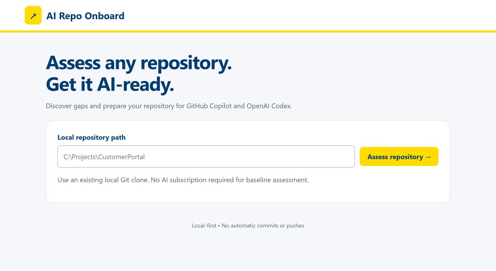
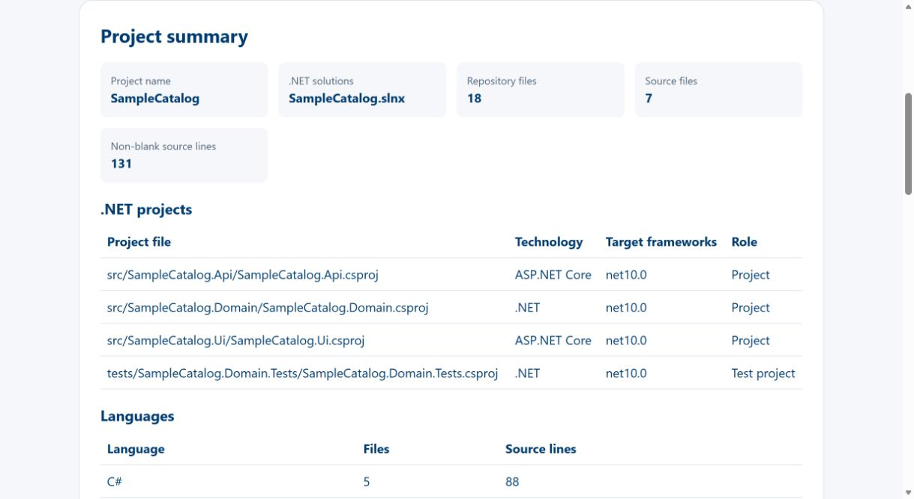
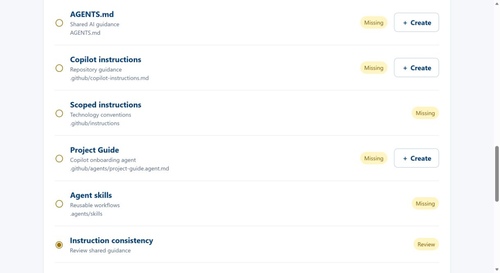
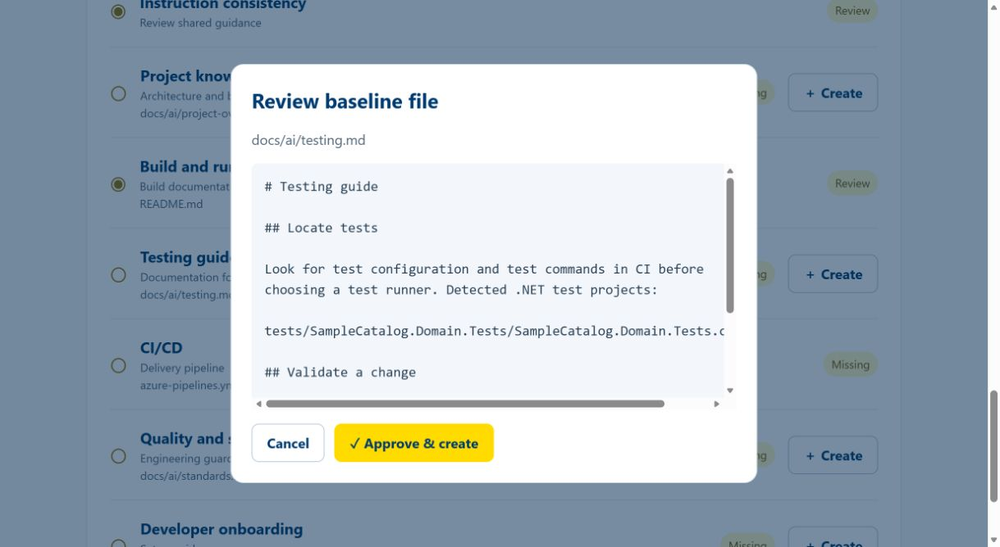
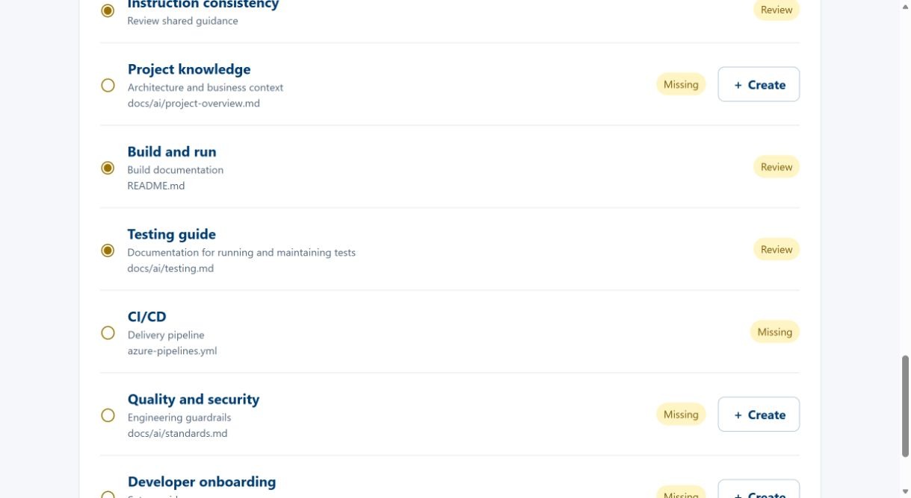
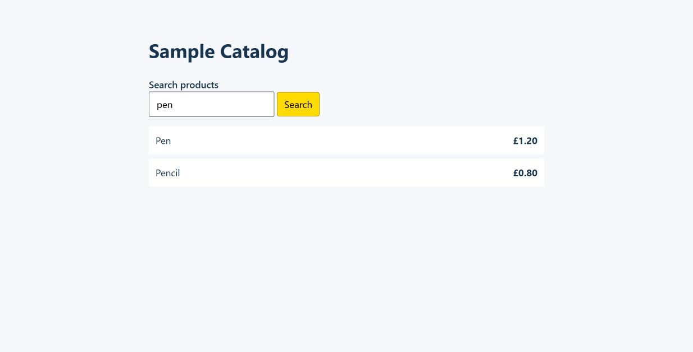

# AI Repo Onboard

Assess a local Git repository for AI readiness and see what guidance is missing for GitHub Copilot and OpenAI Codex. The toolkit runs on Windows and works with a local browser. The baseline scan requires no AI subscription.

## 1. Clone and launch

You need Git, Windows PowerShell, and permission to use local port `8765`. The .NET 10 SDK is needed only to build and run the bundled sample.

Open PowerShell in the folder where you want the clone.

```powershell
git clone https://github.com/fenildesai/ai-repo-onboard.git
cd ai-repo-onboard
.\Start.cmd
```

Keep the launcher window open. It starts the local service and opens AI Repo Onboard in your default browser. If you already have a clone, run `git pull --ff-only` from its root and restart the launcher.



## 2. Choose a repository

Use an existing local Git clone, or make a separate working copy of the bundled [SampleCatalog .NET 10 solution](examples/SampleCatalog).

From the toolkit root, run the following in a second PowerShell window. Choose an unused sibling folder name if `SampleCatalog-Demo` already exists.

```powershell
Copy-Item -LiteralPath .\examples\SampleCatalog -Destination ..\SampleCatalog-Demo -Recurse
git -C ..\SampleCatalog-Demo init
(Resolve-Path ..\SampleCatalog-Demo).Path
```

Paste the printed path into **Local repository path** and select **Assess repository**. The separate copy lets you try file creation without modifying your toolkit clone.

## 3. Read the project summary and checklist

**Project summary** lists detected solutions, projects, technologies, target frameworks, and source counts by language. A clean SampleCatalog copy has four `net10.0` projects, including one unit-test project, and seven source files across C#, Razor, and CSS.



The scanner counts non-blank source lines, including comments, in tracked and unignored files. It excludes common build, dependency, and generated files. Repository file totals increase when you create an unignored guidance file.

The **Readiness checklist** covers 12 areas, including agent instructions, skills, documentation, testing guidance, and CI/CD.

| Status | Meaning |
| --- | --- |
| **Missing** | The expected path was absent. Selected checks offer a draft. |
| **Review** | The path exists or the check requires manual inspection. Review the content before treating the check as complete. |



## 4. Preview, approve, and verify a draft

In the sample, find **Testing guide** and select **Create**. Review the draft and confirm it names `SampleCatalog.Domain.Tests.csproj`.



Select **Approve & create** to write `docs/ai/testing.md`. The checklist refreshes and shows **Review** for the new guide. Open the file in your sample folder to inspect it, or run `git -C ..\SampleCatalog-Demo status --short` from the toolkit root. Drafts have guidance specific to each check. The toolkit writes a draft only after approval and does not commit or push it.



## 5. Build, test, and view SampleCatalog

The sample includes an ASP.NET Core API, a domain library, a Razor Pages UI, and five xUnit tests. From the toolkit root, run the following with the .NET 10 SDK installed.

```powershell
dotnet build .\examples\SampleCatalog\SampleCatalog.slnx
dotnet test .\examples\SampleCatalog\SampleCatalog.slnx --no-build
```

Open two PowerShell windows at the toolkit root. Run the API in the first and the UI in the second, leaving both windows open.

```powershell
dotnet run --project .\examples\SampleCatalog\src\SampleCatalog.Api --no-launch-profile -- --urls http://localhost:51873
```

```powershell
dotnet run --project .\examples\SampleCatalog\src\SampleCatalog.Ui --no-launch-profile -- --urls http://localhost:51874
```

Open [SampleCatalog](http://localhost:51874) and search for `pen`. You can also open the [API response](http://localhost:51873/products?q=pen). Use **Ctrl+C** in each terminal when you finish. Close the AI Repo Onboard launcher to stop the toolkit.



## Assess the content with Copilot or Codex

Copy the full [`skills/ai-repo-onboard`](skills/ai-repo-onboard) directory to a skill location supported by your installed client. Ask the client to assess your repository using the skill. It guides the client to cite repository evidence, distinguish missing guidance from unverified items, and request approval before editing.

## Current scope and startup troubleshooting

This release supports local Git working copies. Remote repository URLs, platform selection, quality scoring, editing existing files, and a native folder picker are outside the current release. Skill installation and authentication are manual.

If the toolkit does not start, check the launcher window for errors, confirm port `8765` is free, and check that your organisation permits local PowerShell scripts and HTTP listeners.
